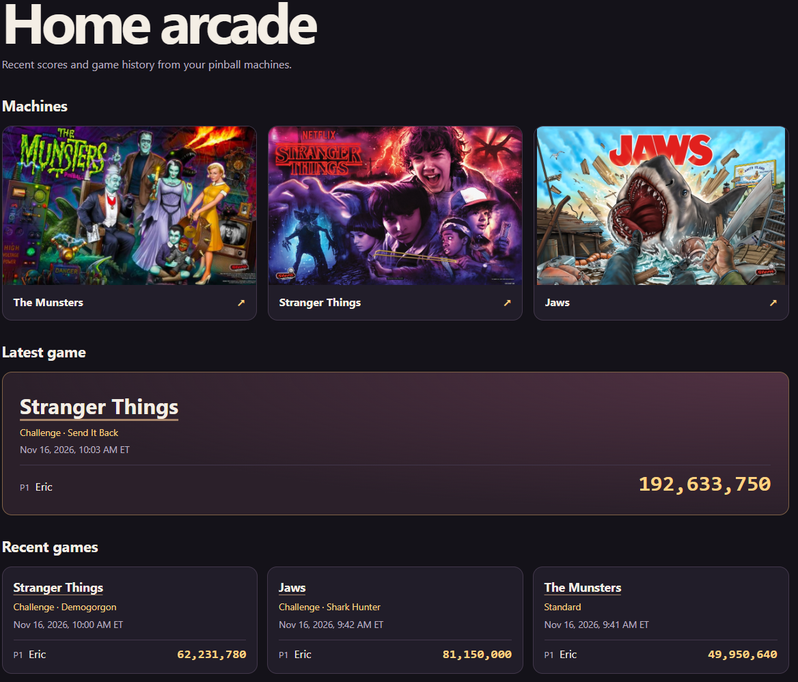
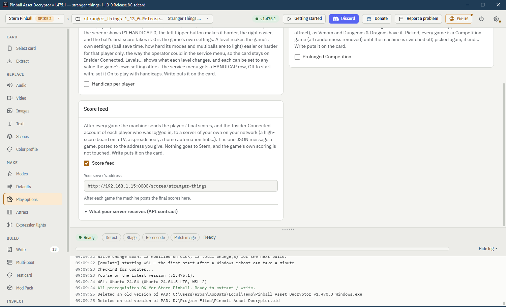
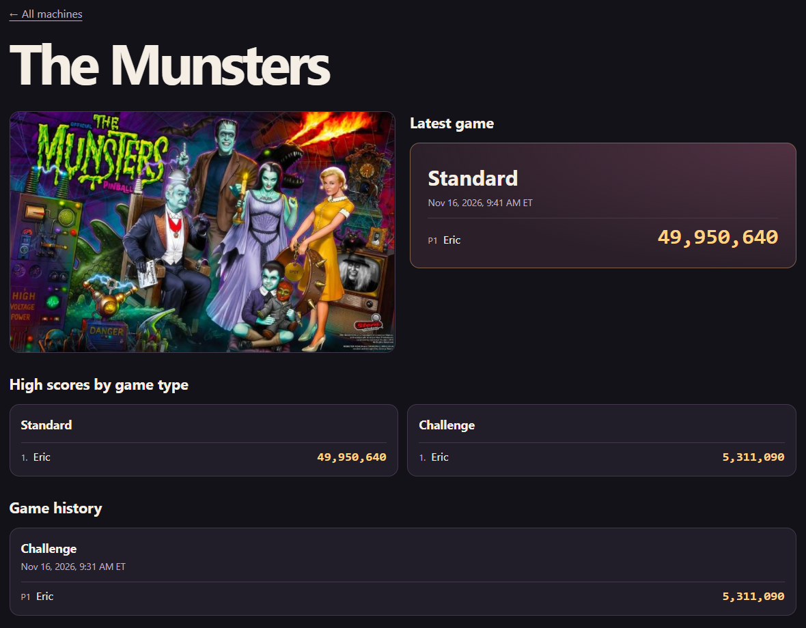
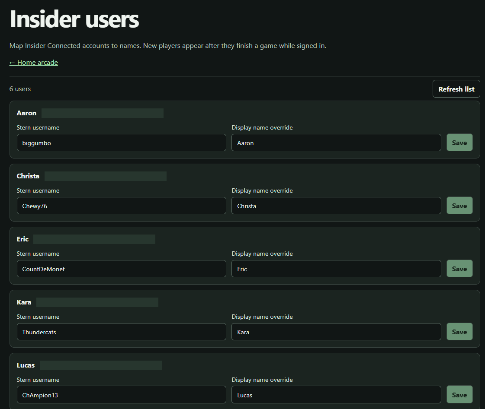

# SternLeaderBoard

Receive end-of-game scores from Pinball Asset Decryptor (PAD) on your home
network. Browse recent games, machine histories, and high scores by game type.



## 1. Set up the Windows PC

1. Install [Node.js 24 for Windows](https://nodejs.org/en/download). Download and
   extract this repository using **Code → Download ZIP**, or clone it with
   GitHub Desktop. The project uses Node's built-in SQLite support.
2. Open `config.json` and edit `games` for your machines. The key is the URL
   slug, such as `stranger-things`, and the value is the name shown on the site.
   Keep `host` set to `0.0.0.0` to accept connections from your LAN.
3. Open PowerShell in the folder containing `server.mjs` and run:

   ```powershell
   node --version
   node server.mjs
   ```

   Keep the terminal open while collecting scores. Press **Ctrl+C** to stop
   the receiver.
4. Open [the local home page](http://localhost:8080/) on the PC. In another
   terminal, run `ipconfig` and find the **IPv4 Address** for the PC's active
   Ethernet or Wi-Fi adapter. From another device on the same LAN, try
   `http://192.168.1.15:8080/`, replacing `192.168.1.15` with that address.
   If remote devices time out, allow Node.js or inbound TCP port 8080 on the
   Windows **Private** network profile. Keep the receiver on a trusted LAN.

## 2. Enable Score feed on each machine's SD card image

1. Download the image for your exact game and edition (Pro, Premium, or LE)
   from [Stern's SD Card Images page](https://www.sternpinball.com/support/sd-cards/).
   Keep the original card as a backup and prepare a separate card for the build.
2. Install [PAD for Windows](https://github.com/davidvanderburgh/pinball-asset-decryptor/releases).
   Use PAD v1.470.0 or later to report game types and challenge names. If PAD
   shows missing Windows prerequisites, use **Install Missing** in PAD.
3. In PAD, select the Stern platform for your game and open the downloaded
   image in **Select card**. Extract it to a project folder if prompted.
4. Open **Play options**, find **Score feed**, and check the box. In **Your
   server's address**, enter the Windows PC's LAN IPv4 address, port, and that
   machine's `/scores/<slug>` path. For Stranger Things, the example is
   `http://192.168.1.15:8080/scores/stranger-things`. Use the **PC's IP address**
   here. The pinball machine sends its scores to that address.
5. Open **Write** in PAD and build the updated image or write it to the spare
   SD card. With the machine powered off, install the updated card. Connect
   the machine to the same LAN as the PC and finish a game. The receiver
   terminal should log a `SCORE` entry and a POST with status `204`.
   Repeat for each machine using its own slug.



## 3. View scores and manage users

Open the home page and select a machine to see its latest game, paginated
history, and top 10 individual scores per game type. Named challenges have
their own lists. Older reports and reports with a null type appear under
**Unknown game type**. Reload the page to see newly received scores. Times
are shown in Eastern Time.



Select **Manage users** on the home page to map Insider Connected accounts to
names. New accounts appear after finishing a game while signed in. Click
**Refresh list**, enter a Stern username or display-name override, and click
**Save**.



## Optional machine artwork

Put a PNG next to `server.mjs` and map its filename to the same slug used in
`games`. For example, these are the relevant sections of `config.json`:

```json
{
  "games": {
    "stranger-things": "Stranger Things"
  },
  "machine_images": {
    "stranger-things": "strangerthings.png"
  }
}
```

Keep the other settings in your config and restart the receiver after saving.

## Score data and moving the receiver

PAD posts to `/scores/<slug>`. A GET on the same path returns JSON history,
and `GET /scores/<slug>/high-scores` returns the high-score groups. Team games
use individual player scores.

To move the receiver, stop it and copy the project files, artwork, config, and
local SQLite database. If a `scores.sqlite-wal` file is still present while
the receiver is stopped, copy it with the database. Keep the database and its
sidecar files out of Git.
